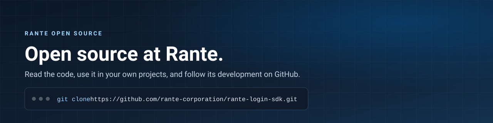

## Get involved

Rante publishes its SDKs and samples under open-source licenses. Read the code, use it in your own projects, and
follow its development here.

* [Explore Rante's open-source projects](https://opensource.rante.com/#projects)
* [Add "Sign in with Rante" to your website](https://github.com/rantegraph/rante-login-sdk), with
  [server-side SDKs](https://github.com/rantegraph/rante-login-sdk#server-side-sdks) for Node.js, Python, .NET,
  Java, Go and PHP
* [Build on Rante's APIs](https://developer.rante.com/)
* [Explore open-source jobs at Rante](https://careers.rante.com/)
<!-- Rante credits for open-source projects: add a link here once rante-credits is live. -->
* Use [repository issues](https://docs.github.com/en/issues/tracking-your-work-with-issues/creating-an-issue) to ask
  questions about a single Rante repository.

Visit [opensource.rante.com](https://opensource.rante.com) to learn more!

----

Rante projects adopt the [Contributor Covenant](https://www.contributor-covenant.org/version/2/1/code_of_conduct/); see
our [code of conduct](https://github.com/rantegraph/.github/blob/main/CODE_OF_CONDUCT.md). To report a security
vulnerability, follow our [security policy](https://github.com/rantegraph/.github/blob/main/SECURITY.md).
