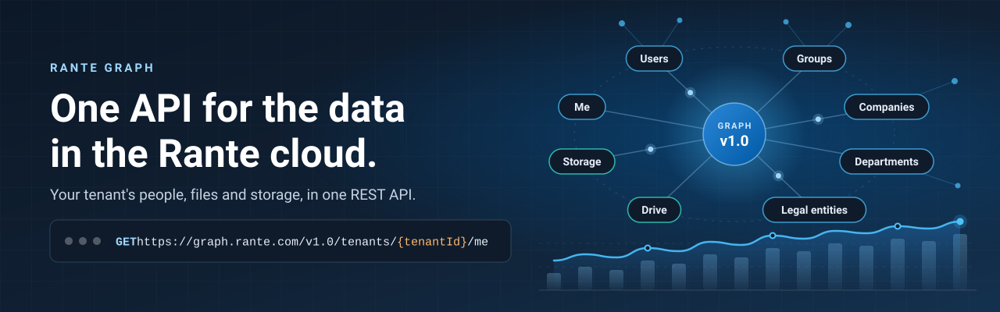

Rante Graph is one REST API for the data in your Rante tenant: the signed-in user, your users, groups, companies,
departments and legal entities, the files in each person's drive, and your storage accounts. Every request is
authenticated, checked against the credential's allowed APIs, and recorded in your tenant's usage.

## Get started

* [Read the Rante Graph guide](https://developer.rante.com/graph): base URLs, authentication, errors and every endpoint
* [Try it in Graph Explorer](https://developer.rante.com/graph/graph-explorer): run real requests from your browser with
  your own credential
* [Get an API key](https://portal.rante.com/dev/api-keys) or [follow the quickstart](https://portal.rante.com/dev/quickstart)
  in the developer console
* [Get the OpenAPI description](https://graph.rante.com/v1.0/openapi.json) for code generators and API tools
* [Learn to build with Rante](https://learn.rante.com/) with the product documentation

Your first call returns the calling credential's tenant, key, allowed APIs and developer app:

```bash
curl https://graph.rante.com/v1.0/tenants/{tenantId}/context \
  -H "Authorization: Bearer $RANTE_ACCESS_TOKEN"
```

Call Rante Graph from your server: it doesn't answer browser (CORS) requests.

## APIs

| API | What it covers | Base URL |
|---|---|---|
| [Users and directory](https://developer.rante.com/me) | The signed-in user (`/me`), and your tenant's users, groups, companies, departments and legal entities | `https://graph.rante.com/v1.0` |
| [Rante Drive](https://developer.rante.com/drive) | Files, folders and received chat documents in a user's drive | `https://graph.rante.com/v1.0` |
| [Rante Storage](https://developer.rante.com/storage) | Storage accounts with their own endpoint, roles and access keys | `https://{account}.drive.rante.com` |
| [Rante Login](https://developer.rante.com/login) | OpenID Connect and OAuth 2.0: tokens, keys and discovery | `https://login.rante.com` |

Every Rante Graph path starts with `/tenants/{tenantId}`, your tenant's directory ID.

## Authentication

Each API key uses one method, fixed when you create it: a bearer API key, an OAuth 2.0 access token for a developer app,
a signed JWT, OAuth 1.0a, or a client certificate (mutual TLS) at `https://mtls.graph.rante.com/v1.0`. Each credential
calls only the APIs you allow it to. Create keys in [API keys](https://portal.rante.com/dev/api-keys) and register apps
in [Developer apps](https://portal.rante.com/dev/apps).

## Sign in with Rante

Add "Sign in with Rante" to your website. Each server-side SDK runs the OpenID Connect code flow with PKCE, supports
`private_key_jwt`, validates ID tokens, and comes with an example website.

| Repository | For |
|---|---|
| [rante-login-sdk](https://github.com/rantegraph/rante-login-sdk) | Browsers: the "Sign in with Rante" button, FedCM, and the redirect with PKCE |
| [rante-login-sdk-node](https://github.com/rantegraph/rante-login-sdk-node) | Node.js |
| [rante-login-sdk-python](https://github.com/rantegraph/rante-login-sdk-python) | Python |
| [rante-login-sdk-dotnet](https://github.com/rantegraph/rante-login-sdk-dotnet) | .NET |
| [rante-login-sdk-java](https://github.com/rantegraph/rante-login-sdk-java) | Java |
| [rante-login-sdk-go](https://github.com/rantegraph/rante-login-sdk-go) | Go |
| [rante-login-sdk-php](https://github.com/rantegraph/rante-login-sdk-php) | PHP |

## More from Rante

* [Rante Developers](https://developer.rante.com/): products, Graph Explorer and the developer console
* [Rante Learn](https://learn.rante.com/): documentation for Rante's APIs and Rante Login
* [Rante Open Source](https://opensource.rante.com/) and [Rante on GitHub](https://github.com/rante-corporation)
* [Rante.com](https://rante.com/)

Use [repository issues](https://docs.github.com/en/issues/tracking-your-work-with-issues/creating-an-issue) to ask
questions about a single repository.

----

Rante projects adopt the [Contributor Covenant](https://www.contributor-covenant.org/version/2/1/code_of_conduct/); see
our [code of conduct](https://github.com/rantegraph/.github/blob/main/CODE_OF_CONDUCT.md). To report a security
vulnerability, follow our [security policy](https://github.com/rantegraph/.github/blob/main/SECURITY.md).

[Privacy Statement](https://rante.com/privacy) · [Terms of use](https://rante.com/terms) ·
[Trademarks](https://rante.com/legal/intellectualproperty/trademarks) · [Contact Rante](https://rante.com/contact-us)
